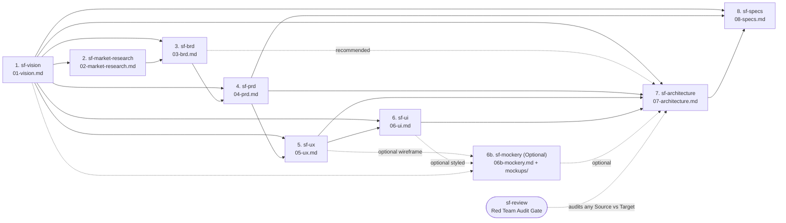

<p align="center">
  
</p>

# Software Factory (`software-factory`)

A lightweight, MIT-licensed, Directed Acyclic Graph (DAG) suite of agentic skills for building software through staged, human-validated phases without schema bloat or context drift.

## Core Design Principles

1. **80/20 Hybrid Artifact (Dual-Format):** Every pipeline skill produces a single markdown artifact made of ~80% human-readable narrative (for review and discussion) and ~20% machine-readable strict JSON inside a trailing `<system_state>...</system_state>` block.
2. **Strict `<system_state>` Handoff:** Downstream skills ingest upstream `<system_state>` blocks as hard ground truth. When working in a workspace, each stage writes its artifact under `docs/factory/` and downstream skills check explicit prompt inputs, current conversation turns, and `docs/factory/` in order before triggering the Missing-Input Guard; if required upstream state is still missing, downstream skills pause rather than inventing requirements.
3. **Universal Adversarial Reviewer (`sf-review`):** One parameterized Red Team skill audits any downstream Target artifact against one or more upstream Source artifacts, checking for constraint violations, scope creep, missing logic, and `<system_state>` validity/parity.

> **Zero Always-On Rules/Hooks Overhead (Router-Only Metadata):** This plugin intentionally omits always-on rule files (`AGENTS.md`, `GEMINI.md`, `CLAUDE.md`, `rules/`), hooks, and bundled MCP servers. Only lightweight skill router frontmatter (`~1.0k–1.1k` estimated tokens across all 12 skills, well below the `1,500`-token CI budget) loads into the router until you activate a stage.

## Pipeline DAG



## Skill Reference

| Skill | Phase | Required Upstream Inputs | `<system_state>` Outputs | Canonical Artifact Path |
| :--- | :--- | :--- | :--- | :--- |
| `sf-vision` | `vision` | Initial idea + constraints | `project_name`, `primary_user`, `ux_tone`, `hard_constraints`, `explicitly_out_of_scope` | `docs/factory/01-vision.md` |
| `sf-market-research` | `market-research` | `sf-vision` | `competitors`, `market_gap_defined`, `validation_status`, `identified_risks` | `docs/factory/02-market-research.md` |
| `sf-brd` | `brd` | `sf-vision`, `sf-market-research` | `monetization_model`, `core_kpis`, `compliance_requirements`, `budget_or_timeline_constraints` | `docs/factory/03-brd.md` |
| `sf-prd` | `prd` | `sf-vision`, `sf-brd` | `core_flows`, `business_rules`, `required_integrations`, `edge_case_mitigations` | `docs/factory/04-prd.md` |
| `sf-ux` | `ux` | `sf-prd`, `sf-vision` | `screens_required`, `primary_navigation_pattern`, `key_interactions`, `accessibility_requirements` | `docs/factory/05-ux.md` |
| `sf-ui` | `ui` | `sf-vision`, `sf-ux` | `css_framework_recommendation`, `color_palette`, `typography`, `border_radius_base` | `docs/factory/06-ui.md` |
| `sf-mockery` *(optional)* | `mockery` | `sf-vision`, `sf-ux`, `sf-ui` (`sf-ui` optional in wireframe mode) | `fidelity`, `mockups_dir`, `devices`, `sections`, `screens`, `components`, `edges_count`, `tokens_synced_from_ui` | `docs/factory/06b-mockery.md` + `docs/factory/mockups/` |
| `sf-architecture` | `architecture` | `sf-prd`, `sf-ux`, `sf-ui`, `sf-vision` (`sf-brd` recommended; `sf-mockery` optional) | `frontend_stack`, `backend_stack`, `database_type`, `data_models`, `core_endpoints` | `docs/factory/07-architecture.md` |
| `sf-specs` | `specs` | `sf-prd`, `sf-architecture`, `sf-vision` | `openapi_stubs`, `required_unit_tests`, `required_e2e_tests`, `linter_rules` | `docs/factory/08-specs.md` |
| `sf-review` | `review` | 1+ upstream Source artifact(s) + 1 Target artifact | `source_phases`, `target_phase`, `verdict`, `critical_violations_count`, `scope_creep_warnings_count`, `blocking_issues` | `docs/factory/reviews/<source>-vs-<target>-review.md` |
| `sf-tree` *(read-only)* | *(inspector)* | Workspace `docs/factory/` and/or Linear / `work-graph` v1 JSON | Dual-mode v1 JSON (Work Tech-Tree & Pipeline Stages), Mermaid DAG, ASCII tree, or live web UI | *(read-only; writes zero repo files)* |
| `sf-telemetry` *(on-demand)* | *(calibration)* | Fibonacci estimate + optional Linear comments or agent JSONL transcript | Canonical v2 JSONL records (`schema_version: "2.0"`), Linear closing comments, calibration & blowup reports (`--json`/`--markdown`/`--ascii`) | Out-of-repo `~/.config/software-factory/telemetry/<slug>-<sha256-8>.jsonl` (`0o600`) |

## Live Project & Tech-Tree View (`sf-tree`)

Invoke `sf-tree` at any point to visualize either your **Work-Item / Ticket Dependency Tech-Tree** (Linear projects, milestones, `blocks`/`blockedBy` chains, ready vs. blocked work, estimate-weighted remaining Critical Path) or your **01–08 Pipeline Stages** (`docs/factory/` progress, `<system_state>` validity, `sf-review` gates, staleness blast radius, and Stage 6b Mockery parity)—powered by zero-dependency Node.js 22+ scripts under `skills/sf-tree/scripts/`:

- **Work Tech-Tree Mode (`--work-graph` / `--linear-project` / `--linear-team`):** Normalizes Linear MCP snapshots (`--work-graph <scratch-path>`, zero API keys required) or optional live Linear GraphQL (`LINEAR_API_KEY`, Node 22 native `fetch`) into canonical `work-graph` v1 JSON, computes deterministic Kahn's topological tiers (with cycle guard), derives `DONE` / `IN REVIEW` / `IN PROGRESS` / `READY` / `BLOCKED` status, and calculates the estimate-weighted remaining Critical Path.
- **Pipeline Stages Mode (`--dir`):** Emits a concise status summary (completed stages, unlocked next stages, stale/failing review gates, semantic warnings) plus a color-coded Mermaid DAG in chat.
- **Dual-Mode Live Local Web Viewer (`--serve`):** Starts a strictly read-only HTTP + Server-Sent Events server on `127.0.0.1` (default port `4173` with automatic free-port fallback) backed by modular `scripts/ui/` assets and shared `lib/` stdlib helpers, featuring a **Work Tech-Tree | Pipeline Stages** switcher, Project/Milestone filter dropdown, Quick Filters (`All`, `Ready to Start`, `In Progress`, `Blocked`, `Hide Done`), **Highlight Critical Path** & **Highlight Stale Blast Radius** toggles, `review_stale` review-freshness tracking, clickable Blocker/Unlock jump links, allowlisted `https://` Linear/PR deep links, XSS-safe Markdown preview, and 1-click **Copy Prompt** helpers.
- **Cross-Harness Graceful Degradation:** Identical `--json`, `--mermaid`, `--ascii`, and `--serve` behavior across **Antigravity**, **Claude Code**, **OpenAI Codex**, and **Gemini CLI** with zero external npm dependencies and zero repo pollution.

```bash
# Work Tech-Tree from an agent-generated Linear MCP snapshot (prefer out-of-repo scratch path)
node skills/sf-tree/scripts/cli.mjs --work-graph /path/to/scratch/work-graph.json --mermaid
node skills/sf-tree/scripts/cli.mjs --dir /path/to/repo --work-graph /path/to/scratch/work-graph.json --serve --port 4173

# Optional direct Linear GraphQL polling (reads LINEAR_API_KEY from env; never persisted)
node skills/sf-tree/scripts/cli.mjs --linear-team SOF --serve --port 4173 --poll-ms 30000

# Pipeline Stages snapshot outputs or live viewer
node skills/sf-tree/scripts/cli.mjs --dir /path/to/repo --view pipeline --json
node skills/sf-tree/scripts/cli.mjs --dir /path/to/repo --view pipeline --mermaid
node skills/sf-tree/scripts/cli.mjs --dir /path/to/repo --serve --port 4173
```

## Agile Sizing & Token/Cost Telemetry (`sf-telemetry`)

Invoke `sf-telemetry` on demand to validate Fibonacci estimates (`1, 2, 3, 5, 8` with mandatory split gate on `8`-pt epics), record v2 model/token/cost/rework telemetry (`schema_version: "2.0"` with non-overlapping `uncached_input_tokens`, `cache_read_tokens`, `cache_write_tokens`, and `output_tokens`) to a private out-of-repo hashed JSONL store (`~/.config/software-factory/telemetry/<slug>-<sha256-8>.jsonl`, mode `0o600`), import Linear bootstrap telemetry comments or local agent JSONL transcripts, and generate calibration & blowup reports—with **0 always-on hooks**, **0 always-on rules**, and zero external npm dependencies:

```bash
# Enforce 8-point epic split gate
node skills/sf-telemetry/scripts/cli.mjs size-check --estimate 5 --json

# Log v2 telemetry (auto-estimates USD from built-in offline pricing table when tokens are given)
node skills/sf-telemetry/scripts/cli.mjs log \
  --issue SOF-26 --model "Gemini 4 Neon (High)" --estimate 5 --felt 3 \
  --uncached-input-tokens 45000 --cache-read-tokens 40000 --output-tokens 14000 \
  --execution smooth

# Import Linear bootstrap comments or local agent JSONL transcript, then generate filtered calibration report
node skills/sf-telemetry/scripts/cli.mjs import-bootstrap --input /path/to/scratch/comments.json
node skills/sf-telemetry/scripts/cli.mjs report --markdown --project P-SOF-6 --since 2026-01-01
```

## Optional Interactive Mockups (`sf-mockery`)

Between UX/UI and Architecture, you can optionally invoke `sf-mockery` to generate a clickable, pannable **Mockery** flow canvas under `docs/factory/mockups/` (`flow.json`, static HTML screens, reusable `<x-include>` partials, `tokens.css`, `kit.css`) alongside `docs/factory/06b-mockery.md`—powered by a **built-in, zero-dependency Node.js 22+ runtime** under `skills/sf-mockery/scripts/` (no separate Mockery install, `npm`, or `npx` required):

- **Styled Mode (default, after `sf-ui`):** Maps `sf-ux` screens/transitions and `sf-ui` design tokens directly into `docs/factory/mockups/`.
- **Wireframe Mode (optional, after `sf-ux`):** Generates neutral grayscale screens so you can inspect flows before `sf-ui`, then restyles `tokens.css` and `kit.css` in place after `sf-ui` completes.
- **Standalone Offline Export (`export`):** Compiles the entire canvas (screens, components, tokens, local `assets/`, and viewer) into a single self-contained `preview.html` file that stakeholders can double-click and pan/zoom/click through in any browser with zero server or Node.js installed.
- **Zero Lock-In:** Baseline `sf-ux` → `sf-ui` → `sf-architecture` works identically if you skip Stage 6b.

```bash
# Validate flow.json, screens, <x-include> components, edges, and static lints
node skills/sf-mockery/scripts/cli.mjs check docs/factory/mockups

# Start the live hot-reload flow canvas viewer on 127.0.0.1:5180 (auto-detects docs/factory/mockups)
node skills/sf-mockery/scripts/cli.mjs serve docs/factory/mockups

# Bundle into one standalone offline preview.html (zero server or Node.js needed to open)
node skills/sf-mockery/scripts/cli.mjs export docs/factory/mockups
```

## Prompting Guide, Zero-Dep Architecture & Automated Tests

- **Operator Prompting Guide:** See [`docs/PROMPTING_GUIDE.md`](docs/PROMPTING_GUIDE.md) for copy-paste starter prompts across all 12 skills, high-signal vs. anti-pattern prompt comparisons, recovery playbooks (Missing-Input Guard, `sf-review FAIL`, stale blast radius, 8-pt epic splits), and cross-harness tips (Antigravity, Claude Code, OpenAI Codex, Gemini CLI).
- **Zero-Dependency `lib/` Architecture:** Shared Node.js 22+ stdlib primitives live under `lib/` (`lib/cli-utils.mjs`, `lib/fs-safe.mjs`, `lib/http-sse.mjs`) and power `sf-tree`, `sf-mockery`, and `sf-telemetry` with symlink/path-containment guards, localhost HTTP+SSE helpers, and zero external npm packages.
- **Automated Evals & Unit Tests (`evals/run.mjs` & `tests/*.test.mjs`):** Deterministically audits all 12 skills, golden end-to-end PulseBoard `<system_state>` schemas + negative defect cases, Missing-Input Guard & `sf-review` coverage, and idle router token budgets, paired with `node --test` unit/security/regression suites (CI-enforced via `.github/workflows/ci.yml`):

```bash
# Run all 4 eval suites (skills, schemas, guards, tokens) offline with Node 22+
node evals/run.mjs --ascii
node evals/run.mjs --markdown
node evals/run.mjs --json

# Run Node.js 22+ unit, security, and regression tests
node --test tests/*.test.mjs
```

## Installation & Versioning

### Antigravity

Validate and install locally or from a versioned Git tag:

```bash
# Validate the plugin bundle
agy plugin validate --strict /path/to/software-factory-plugin

# Install from a local checkout
agy plugin install /path/to/software-factory-plugin

# Or install a pinned version from GitHub
agy plugin install https://github.com/software-factory-plugin/software-factory-plugin/tree/v0.9.0
```

Alternatively, register the local directory in `~/.gemini/config/plugins.json` (global) or `.agents/plugins.json` (workspace):

```json
{
  "entries": [
    { "path": "/path/to/software-factory-plugin" }
  ]
}
```

### Claude Code

Uses `.claude-plugin/plugin.json` and `.claude-plugin/marketplace.json` together with the shared `skills/` directory at the repository root. Install directly from GitHub via Claude Code's marketplace loader:

```text
/plugin marketplace add software-factory-plugin/software-factory-plugin
/plugin install software-factory@software-factory-marketplace
```

### OpenAI Codex

Uses `.codex-plugin/plugin.json` (`"skills": "./skills/"`) and `.agents/plugins/marketplace.json` together with the shared `skills/` directory at the repository root. Point Codex's `/plugins` marketplace loader at `software-factory-plugin/software-factory-plugin` (or add the repository as a marketplace source).

### Gemini CLI

Link the local checkout during development using `gemini-extension.json`:

```bash
gemini extensions link .
```

### Releasing a New Version

Keep `version` synchronized across all plugin and marketplace manifests (`plugin.json`, `.claude-plugin/*`, `.codex-plugin/*`, `.agents/plugins/marketplace.json`, `gemini-extension.json`) and `README.md` using the bundled zero-dependency sync helper before tagging:

```bash
# Sync all 6 plugin/marketplace manifests and README.md
node scripts/bump-version.mjs 0.9.1

# Verify version parity, unit tests, evals, and strict plugin validation
node scripts/bump-version.mjs --check
node --test tests/*.test.mjs
node evals/run.mjs --ascii
agy plugin validate --strict .
```

Then commit and push a matching annotated Git tag and GitHub Release (for example, `v0.9.1`).

## Roadmap

Active roadmap planning, design specs, and issue tracking live in [Linear (`SOF`)](https://linear.app/software-factory-plugin):

- **Mockery Integration (Shipped — `v0.2.0` / `v0.9.0`):** Optional `sf-mockery` bridge skill connecting interactive Mockery flow canvases into UX/UI, `sf-review`, and `sf-architecture`, backed by a bundled zero-dependency Node.js 22+ runtime (`check`, `serve`, standalone single-file `export`).
- **Live Project & Tech-Tree View (Shipped — `v0.3.0` / `v0.4.0`):** Dual-mode read-only `sf-tree` skill and zero-dep Node 22+ DAG analyzer/live SSE web viewer covering both Work-Item / Linear Dependency Tech-Trees (topological tiers, ready vs. blocked work, Critical Path) and 01–08 Pipeline Stages (staleness blast radius, `sf-review` gates, `review_stale` freshness, Mockery parity).
- **Agile Sizing & Token/Cost Telemetry (Shipped — `v0.5.0`):** On-demand `sf-telemetry` skill and zero-dep Node 22+ CLI pairing Fibonacci sizing (`1, 2, 3, 5, 8`) with v2 non-overlapping token buckets, offline token/cost pricing, Linear bootstrap & streaming transcript parsers, hashed out-of-repo JSONL storage, and calibration/blowup reports.
- **Prompting Guide & Evals (Shipped — `v0.6.0`):** Comprehensive operator handbook (`docs/PROMPTING_GUIDE.md`) plus zero-dep Node 22+ automated eval suite (`evals/run.mjs`, golden PulseBoard fixtures, 4 suites, GitHub Actions CI) verifying frontmatter, `<system_state>` fidelity, Missing-Input Guards, `sf-review` vectors, and idle-router token budgets.
- **Marketplace Publishing (Shipped — `v0.7.0` / `v0.7.1`):** MIT `LICENSE`, minimal SVG logo (`assets/logo.svg`), cross-harness manifests and marketplace registries (Antigravity, Claude Code, OpenAI Codex, Gemini CLI), release version-sync automation, community templates, and zero-warning strict validation.
- **Built-In Prompt Quality Gate (Shipped — `v0.8.0`):** Context-aware prompt evaluation embedded across all 12 skills with 1-turn gap diagnosis, placeholder-based High-Signal Prompt suggestions, targeted follow-ups, soft override/upfront bypass support with **Assumptions Used** transparency, and automated contract evals (`156/156` checks).
- **Security, Modularity & Contract Hardening (Shipped — `v0.9.0`+):** Shared zero-dep `lib/` primitives (`cli-utils`, `fs-safe`, `http-sse`), strict `<system_state>` validation, `sf-telemetry` v2 schema & lockfile hardening, modular `sf-tree` UI, comprehensive `node --test` suites, and tightened skill contracts & router token budgets.

## License

MIT License — see [`LICENSE`](LICENSE). Contributions welcome via [`CONTRIBUTING.md`](CONTRIBUTING.md).
